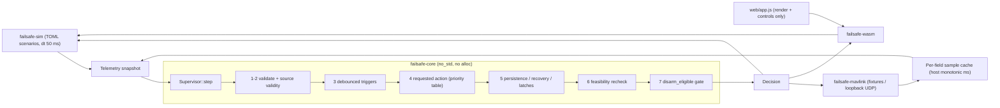

# Rust portfolio demo: ideas, pick and build plan

Prepared 2026-10-22 (America/Denver) for Arpan Bom (`applycoding`). **Not built.** A Cursor cloud agent builds it later from the PLAN section below (lifecycle step 5: commit PLAN.md to the new repo, model composer-2.5, fast=false).

## Overlap check
`gh repo list applycoding` shows **no public Rust repo**. Related repos to stay clear of:
- `cpp-flight-controller`: C++20 PID control and Kalman/complementary fusion.
- `px4-drone-mission-planner`: Python, pre-flight geofence and RTH energy check, MAVSDK.
- `teleop-console-demo`: diff-drive robot, e-stop, watchdog.
- `humanoid-arm-teleop`, `ros2-vision-tracking-demo`, `edge-yolo-tensorrt`, `edge-vision-detector`, `robot-learning-vla-demo` (SimReach), `embedded-motor-controller` (C++17).
- `multi-robot-warehouse-planner`: empty right now, probably mid-build.
- `robot-fleet-mqtt-telemetry`, `ros2-drone-mission-sim`, `lidar-shape-classifier-ros2`.

## Three ideas

| # | Idea | Why it fits | Weak spots |
|---|---|---|---|
| 1 | **`rust-drone-failsafe`**: a `no_std` runtime failsafe supervisor for drones. It takes geofence, link-loss, GPS/EKF and battery inputs and makes energy-aware RTL-vs-land decisions with debounce, hysteresis and latches. The same core is cross-compiled for Cortex-M4F, run in a Rust sim with golden traces, fed from MAVLink fixtures, and played in a browser via WASM. | Drones + embedded + safety: exactly "when safety and performance both matter". Shows off Rust's real advantages (`no_std`, no heap, `forbid(unsafe)`, property tests). A live in-browser demo for the tutorial and README GIF. Fully testable on Ubuntu CI. Complements, without duplicating, the C++ flight controller (control) and the PX4 planner (pre-flight planning). | MAVLink crate churns fast (mitigated: a spike first, an isolated adapter). |
| 2 | **`rust-robot-bus`**: a zero-copy, lock-free pub/sub middleware for robot sensor streams (SPSC/MPMC ring buffers, shared memory, deterministic executor). Includes latency histograms vs a channel baseline, `loom` concurrency tests and criterion benchmarks. | Strong systems signal (ROS 2 middleware internals, like Titan's stack). Great benchmark charts. | Abstract, with no visual demo. Benchmarks on shared CI runners are noisy. Harder for non-specialists to appreciate. Easy to write subtle `unsafe` that reviewers will pick apart. |
| 3 | **`rust-edge-vision`**: pure-Rust ONNX inference (`tract`) for a small detector, plus a SORT/ByteTrack-style tracker and a WASM demo. | Edge AI in Rust. A visual demo. | Overlaps `edge-yolo-tensorrt`, `edge-vision-detector` and `ros2-vision-tracking-demo`. CPU inference in CI is slow, and model weights and licenses add friction. |

**Pick: idea 1, `rust-drone-failsafe`.**
- It's the only idea that ties together drones, embedded/edge and safety-critical Rust in one small repo with no overlap.
- It runs the same `no_std` core on three targets (MCU cross-build, host sim, browser). That's a memorable tutorial hook and a live demo for the profile.
- Every claim can be checked in CI with no hardware.

## How this plan was made (plan-check-build lifecycle)
1. **Draft:** Antigravity, model `claude-opus-5-5-high` (planning only).
2. **Check:** `codex exec --sandbox workspace-write`, which wrote 34 findings (1 critical, about 25 high).
3. **Verify (by hand):**
   - Versions confirmed on the crates.io API today: Rust 1.99.1, mavlink 0.20.0 (MSRV 1.88; 3 releases in 2 weeks), toml 1.1.8, clap 4.6.7, csv 1.4.0, wasm-bindgen(-cli) 0.2.129, proptest 1.12.0, libm 0.2.16, serde 1.0.229.
   - mavlink 0.20 feature names checked: `dialect-common`, `transport-udp`; there are no `common` or `udp` features.
   - MAVLink fields checked against `common.xml`: AHRS bit 0x200000, RC receiver bit 0x10000, `energy_consumed` in hJ (/36 → Wh, -1 = unknown), `relative_alt` in mm, `eph` = HDOP×100, `landed_state` in EXTENDED_SYS_STATE.
   - Energy example recomputed: 21.5625 / 29.5625 / 34.5625 / 3.3333 Wh, correct.
   - Codex's claim that "energy is monotonic in altitude" is a false property, and I confirmed it: E_rtl at d=0 is 3.333, 1.667 and 3.333 Wh at h = 0, 30 and 60 m.
   - Confirmed by reasoning: the Disarm-stuck-on-recovery hazard and the overlapping marginal hysteresis.
   - Dropped Codex's caveat about not being able to reach crates.io; I checked the versions directly.
4. **Revise:** same Antigravity Opus model with all 19 verified findings inline. One small wording fix was made by hand (success criterion 11).

Working files are on the box in `/workspace/rustplan/`: `PLAN_draft.md`, `REVIEW_codex.md`, `findings.txt`, `PLAN_rev.md`.

---

## The build plan (PLAN.md to commit to the new repo)

# PLAN.md: `rust-drone-failsafe`

## 1. Goal and audience
This repo is an educational drone failsafe supervisor written in `no_std` Rust. It is **advisory only**: it reads telemetry and recommends an action. Its safety logic is deterministic, heap-free and panic-free. It is property-tested on the host, cross-compiled for Cortex-M4F (`thumbv7em-none-eabihf`) and runs in a browser through WASM. It needs no hardware. It is written for robotics and drone hiring managers, embedded Rust engineers and applycoding.com readers.

The supervisor never commands anything. Each tick it outputs:
- a recommended `Action`
- a display `Reason`
- the set of active triggers
- energy diagnostics
- an advisory `disarm_eligible` flag

It does no flight control, mission planning, teleop or perception.

**Honesty rule (README and tutorial):**
- Say it is educational and advisory, host-tested on synthetic traces, and compiled for Cortex-M4F and WASM.
- Say it is not flight-tested and not certified.
- The heap-free and unsafe-free claims cover only the `failsafe-core` source.
- Proptest is sampled evidence, not proof.
- The MAVLink fixtures are synthetic.
- Make no personal-experience claims and no comparisons with other repos.

## 2. Scope
| Crate | Kind | Purpose |
|---|---|---|
| `failsafe-core` | lib, `#![no_std]`, no `alloc`, `#![forbid(unsafe_code)]`, only dependency `libm` | Geometry, energy, triggers, arbiter, disarm gate |
| `failsafe-sim` | lib + bin, std, `forbid(unsafe_code)` | 2.5D point-mass sim, TOML scenarios, CSV traces. File I/O lives only in `main.rs`, so the lib also runs in WASM |
| `failsafe-mavlink` | lib + bin, std, `forbid(unsafe_code)`, feature `udp` | Receive-only MAVLink v2 → `Telemetry` adapter, fixture replay |
| `failsafe-wasm` | cdylib, `unsafe_code` not forbidden because wasm-bindgen output may need it | Wraps `failsafe-sim` for `web/` |

## 3. Architecture


## 4. Pinned toolchain and versions
Versions were checked on crates.io on 2026-10-22. Commit `Cargo.lock`. Every cargo command in CI uses `--locked`.

- **`rust-toolchain.toml`:**
  - `channel = "1.99.1"`
  - components `rustfmt`, `clippy`
  - targets `thumbv7em-none-eabihf`, `wasm32-unknown-unknown`
- **Workspace:** edition 2024, `resolver = "3"`.

| Dependency | Version / features | Used by |
|---|---|---|
| `libm` | `0.2.16` | core, sim |
| `serde` | `1.0.229`, `derive` | sim, wasm, mavlink (**not core**) |
| `serde_json` | `1.0.154` | wasm, sim |
| `toml` | `1.1.8` | sim |
| `csv` | `1.4.0` | sim |
| `clap` | `4.6.7`, `derive` | sim bin, mavlink bin |
| `mavlink` | `{ version = "0.20", default-features = false, features = ["std","dialect-common"] }`, MSRV 1.88 | mavlink |
| `wasm-bindgen` | `=0.2.129` | wasm |
| `wasm-bindgen-cli` | `0.2.129`, the exact version in `Cargo.lock` | CI tool |
| `proptest` | `1.12.0` | core, sim (dev) |

- **`failsafe-mavlink` features:** `udp = ["mavlink/transport-udp"]`.
- **mavlink spike first:** `mavlink` 0.19.0, 0.19.1 and 0.20.0 all shipped within two weeks, so its API is changing fast. Before writing the adapter, the builder writes a tiny encode/decode spike against 0.20: one HEARTBEAT round trip in a unit test.
- **Actions:** pin GitHub Actions to full commit SHAs, resolved at build time and annotated with a version comment.
- **Playwright:** pin it through `web/package-lock.json`.

## 5. Layout
```
Cargo.toml  Cargo.lock  rust-toolchain.toml  deny.toml  README.md  LICENSE-MIT  LICENSE-APACHE
crates/failsafe-core/src/{lib,types,config,validate,time,geometry,energy,triggers,arbiter,disarm}.rs
crates/failsafe-core/tests/{props.rs,geometry.rs,energy.rs,triggers.rs,pipeline.rs}
crates/failsafe-sim/src/{lib,model,scenario,trace,main}.rs
crates/failsafe-sim/scenarios/*.toml   crates/failsafe-sim/tests/{golden.rs,golden/*.csv}
crates/failsafe-mavlink/src/{lib,map,cache,replay,main}.rs
crates/failsafe-mavlink/tests/{replay.rs,fixtures/{*.rec,heartbeat_handchecked.hex,README.md}}
crates/failsafe-wasm/src/lib.rs
web/{index.html,app.js,style.css,package.json,package-lock.json,playwright.config.js,tests/smoke.spec.js}
.github/workflows/{ci.yml,pages.yml}   docs/{state-machine.md,energy.md}
```
`web/pkg/` is gitignored.

## 6. Core interfaces
```rust
pub const MAX_FENCE_VERTS: usize = 16;
pub const HALF_RANGE_MS: u32 = 0x8000_0000;
#[derive(Clone, Copy)] pub struct Point2 { pub n: f32, pub e: f32 }          // metres, home = origin
#[derive(Clone, Copy)] pub struct Vec3 { pub n: f32, pub e: f32, pub d: f32 } // NED, alt = -d

pub struct ConvexPolygon { verts: [Point2; MAX_FENCE_VERTS], len: u8 }
impl ConvexPolygon {
    pub fn new(pts: &[Point2]) -> Result<Self, FenceError>; // validates, normalises to CCW
    pub fn contains(&self, p: Point2) -> bool;              // boundary counts as inside
    pub fn signed_distance(&self, p: Point2) -> f32;        // min inward edge distance; >= 0 inside
}
pub struct Geofence { poly: ConvexPolygon, max_alt_m: f32, min_alt_m: f32 }
impl Geofence { pub fn new(poly: ConvexPolygon, min_alt_m: f32, max_alt_m: f32) -> Result<Self, FenceError>; }
pub enum FenceError { TooFewVertices, TooManyVertices, NonFinite, OutOfEnvelope, DuplicateVertex,
    CollinearEdge, NotConvex, AreaTooSmall, BadAltitudes }

#[derive(Clone, Copy)] pub struct Stamped<T> { pub t_ms: u32, pub value: T }
pub enum GpsFix { None, Fix2D, Fix3D }
pub enum LandedState { Undefined, OnGround, InAir, Takeoff, Landing }
pub struct PositionSample { pub t_ms: u32, pub pos: Vec3, pub vel: Vec3 }
pub struct GpsSample { pub t_ms: u32, pub fix: GpsFix, pub sats: Option<u8>, pub hdop: Option<f32> }
pub struct BatteryInputs { pub voltage_v: Option<Stamped<f32>>, pub percent: Option<Stamped<f32>>,
    pub remaining_wh: Option<Stamped<f32>> }
pub struct Telemetry {               // snapshot; each field carries its own receive time
    pub now_ms: u32,
    pub position: Option<PositionSample>, pub gps: Option<GpsSample>, pub battery: BatteryInputs,
    pub gcs_heartbeat_ms: Option<u32>,
    pub armed: Option<Stamped<bool>>, pub landed: Option<Stamped<LandedState>>,
    pub rc_ok: Option<Stamped<bool>>, pub ekf_ok: Option<Stamped<bool>>,
}
#[derive(Clone, Copy, PartialEq, Eq)]
pub enum Action { Nominal, Warn, Hold, ReturnToLaunch, Land }  // NO Disarm
impl Action { pub const fn rank(self) -> u8; }                   // explicit table, see §8
pub enum Reason { None, ClockFault, InvalidInput, StaleBattery, GcsLinkLost, RcLost, GpsDegraded,
    GpsLost, EkfUnhealthy, PositionInvalid, FenceApproach, FenceBreach, AltitudeMax, AltitudeMin,
    BatteryWarn, BatteryLow, BatteryCritical, EnergyRtlMarginal, EnergyRtlInfeasible }
pub const N_REASONS: usize = 19;
#[derive(Clone, Copy)] pub struct Request { pub reason: Reason, pub action: Action }
pub struct ActiveSet { reqs: [Option<Request>; N_REASONS] }      // fixed array, no heap
pub struct EnergyEstimate { pub rtl_wh: f32, pub land_wh: f32, pub reserve_wh: f32,
    pub remaining_wh: Option<f32>, pub margin_wh: Option<f32>, pub insufficient_for_landing: bool }
pub struct Decision { pub action: Action, pub reason: Reason, pub requested: Action,
    pub active: ActiveSet, pub position_valid: bool, pub clock_fault: bool,
    pub energy: EnergyEstimate, pub fence_dist_m: Option<f32>, pub disarm_eligible: bool }

pub struct Config { /* every threshold in §8-§9; cell_count: u8, usable_capacity_wh: f32 */ }
impl Default for Config { /* §8-§9 defaults */ }
pub enum ConfigError { Fence(FenceError), HomeOutsideFence, RtlAltOutsideFence, NonFiniteParam,
    NonPositiveSpeed, NegativePower, BadCellCount, BadCapacity, BadThresholdOrder, DurationOutOfRange }
pub struct Supervisor { /* cfg, fence, timers: Option<u32>, latches, prev_output, epoch */ }
impl Supervisor {
    pub fn new(cfg: Config, fence: Geofence) -> Result<Self, ConfigError>;
    pub fn step(&mut self, t: &Telemetry) -> Decision;  // total, never panics
}
pub fn rtl_energy(cfg: &Config, pos: Vec3, remaining_wh: Option<f32>) -> EnergyEstimate;
pub fn age_ms(now: u32, then: u32) -> Option<u32>;      // None if wrapping diff >= 2^31 (future)
```
- **Core lint wall:** core denies `clippy::unwrap_used`, `clippy::expect_used` and `clippy::panic`.
- **Serde boundary:** core has no serde. DTOs live in the sim, wasm and mavlink crates, and they build core types only through the checked constructors.

## 7. Processing pipeline
`step` runs these stages in a fixed order on every tick:

1. **Clock and input validation.**
   - Compute `delta = now.wrapping_sub(last_now)`. If `delta >= 0x8000_0000`, the tick is backwards (see §10).
   - Range-check every field. A non-finite or out-of-range field becomes `None` and raises `InvalidInput`.
   - A NaN never compares as safe: every check is written so that NaN fails it.
2. **Immediate source validity.** `position_valid` is true only when all of these hold:
   - the position sample is present, finite, inside the envelope, and passed the glitch filter
   - it is fresh (age ≤ `pos_fresh_ms` = 500)
   - the EKF sample is fresh and true

   This stage involves no debounce.
3. **Debounced triggers.** Update each trigger's set and clear timers (`Option<u32>`, with no zero sentinel) and its latches. Each active trigger stores a `Request { reason, action }`. GcsLinkLost stores its current stage.
4. **Requested action.** Take the maximum `Action::rank()` over the active requests. The display reason is chosen separately, using the tie order in §8 among requests at that rank.
5. **Persistence and recovery.**
   - If `requested.rank() >= prev_output.rank()`, output `requested` at once.
   - Otherwise, start or continue the recovery timer. Once `requested` has stayed below `prev_output` for `recovery_hold_ms` (default 5000), output the *current* `requested` directly. Do not step through intermediate levels.
   - The timer resets when the requested action rises to `prev_output` or above, on a clock fault, and on a feasibility substitution.
   - Latches (BatteryCritical, EnergyRtlInfeasible) keep the output at Land or above until a confirmed disarm.
6. **Feasibility recheck.** If the output is Hold or RTL and `!position_valid`, the output becomes Land and the reason becomes `PositionInvalid`. Store this post-feasibility action as `prev_output`.
7. **`disarm_eligible` gate**, recomputed from scratch on every tick. It is true only when all of these hold:
   - a fresh `armed == true`
   - a fresh `landed == OnGround`
   - both hold continuously for 2 s
   - the requested action is Land or above

   Any missing, stale, unknown or contrary sample resets the gate immediately, and so does a clock fault. The gate is advisory and never feeds back into the action.

**Confirmed disarm.** A fresh `armed == false` sets the output to Nominal and resets all triggers, latches and timers. Proptests exempt this reset explicitly. If `armed` is unknown or stale, the supervisor assumes armed.

## 8. Triggers, priority and default thresholds
Action rank: Nominal 0 < Warn 1 < Hold 2 < RTL 3 < Land 4. Freshness limits: position 500 ms, GPS 1 s, status fields 1 s, battery 2 s.

| Reason | Set (debounce) | Clear (hysteresis) | Action |
|---|---|---|---|
| GcsLinkLost | Heartbeat age (missing counts as ∞) > 3 s → Warn, > 5 s → Hold, > 15 s → RTL | Age ≤ 1.5 s for 3 s | Warn / Hold / RTL |
| RcLost (`rc_required`, default true) | `rc_ok` false, missing or stale, for 1 s | Fresh true for 3 s | RTL |
| GpsDegraded | sats < 8, HDOP > 2.5, or either unknown, for 2 s | sats ≥ 10 and HDOP ≤ 2.0 for 5 s | Warn |
| GpsLost | Fix below 3D, missing, or stale, for 1.5 s | Fresh 3D fix for 5 s | Land |
| EkfUnhealthy | `ekf_ok` false, missing or stale, for 1 s | Fresh true for 5 s | Land |
| FenceApproach | Valid position, 0 ≤ sd < 10 m | sd > 15 m | Warn |
| FenceBreach | Valid position, sd < 0 for 0.5 s | sd ≥ 5 m for 5 s | RTL |
| AltitudeMax (120 m) | alt > max for 0.5 s | alt < max − 5 m for 3 s | RTL |
| AltitudeMin (5 m) | alt < min, > 20 m horizontally from home, fresh `InAir`, for 1 s | alt > min + 2 m for 1 s, or ≤ 20 m from home | Warn |
| StaleBattery | No fresh voltage **and** no fresh percent (immediate) | Fresh for 3 s | RTL |
| BatteryWarn / BatteryLow | % < 30 / < 20, for 2 s | % > 33 / > 23, for 5 s | Warn / RTL |
| BatteryCritical | % < 10 or V < 3.3 V × `cell_count`, for 3 s | **Latched** until confirmed disarm | Land |
| EnergyRtlMarginal | 0 ≤ margin < 5 Wh for 2 s | margin > 7 Wh for 5 s | RTL |
| EnergyRtlInfeasible | margin < 0 for 2 s | **Latched** until confirmed disarm | Land |
| ClockFault | Backwards tick | First valid forward tick, or re-anchor | Warn (output held) |
| InvalidInput | Any field rejected this tick; the field becomes missing | 3 s with no rejections | Warn |

`PositionInvalid` is display-only: stage 6 sets it as the reason when it substitutes Land.

**Display-reason tie order** (among requests at the winning rank): BatteryCritical > EnergyRtlInfeasible > EkfUnhealthy > GpsLost > PositionInvalid > FenceBreach > AltitudeMax > RcLost > GcsLinkLost > StaleBattery > BatteryLow > EnergyRtlMarginal > ClockFault > InvalidInput > GpsDegraded > FenceApproach > AltitudeMin > BatteryWarn.

**Config validation in `Supervisor::new`:**
- every value is finite
- speeds > 0; powers and reserve ≥ 0
- `cell_count` is 1..=14; `usable_capacity_wh` > 0
- thresholds are ordered: set and clear bands don't overlap, and Warn > Low > Critical
- all durations are 1..=600 000 ms (well under 2^31)
- home (0,0) lies inside the fence, and `h_rtl` lies within [min_alt, max_alt]

**Telemetry range checks:** |n|, |e| ≤ 10 km; alt between −100 and 2000 m; |v| ≤ 100 m/s; percent 0..=100; voltage 0..=100 V; HDOP 0..=100; remaining 0..=1.1 × capacity.

## 9. Energy model and worked example
This is a **heuristic**: it assumes constant power, a fixed wind factor and flat ground. Symbols: `d` = horizontal distance to home, `h` = altitude, `h_rtl` = RTL altitude.
```
E_climb   = max(0, h_rtl − h) / v_climb · P_climb
E_cruise  = d / v_cruise · P_cruise · k_wind
E_descent = max(h, h_rtl) / v_desc · P_desc
E_rtl     = (E_climb + E_cruise + E_descent) / 3600          [Wh]
E_land    = h / v_desc · P_desc / 3600                        [Wh]
margin_wh = remaining_wh − E_rtl − reserve
Infeasible: margin < 0  (latched → Land)      Marginal: margin < 5, clears > 7 for 5 s (→ RTL)
InsufficientForLanding diagnostic: remaining_wh < E_land (sets insufficient_for_landing)
```
- **Where `remaining_wh` comes from:** use the fresh `remaining_wh` sample if there is one. Otherwise use fresh percent × `usable_capacity_wh`. If neither exists, the energy triggers stay inactive and StaleBattery covers the gap.
- **Defaults:** `v_cruise` 10 m/s, `P_cruise` 350 W, `k_wind` 1.25, `v_climb` 2 m/s, `P_climb` 400 W, `v_desc` 1.5 m/s, `P_desc` 300 W, `h_rtl` 30 m, reserve 8 Wh, `v_max` (glitch filter) 25 m/s.

**Worked example** (d = 1500 m, h = 60 m):
- Climb: 0 J, because h > h_rtl.
- Cruise: 150 s × 350 W × 1.25 = 65 625 J.
- Descent: 40 s × 300 W = 12 000 J.
- E_rtl = 77 625 J = **21.5625 Wh**.
- E_rtl + reserve = **29.5625 Wh**. Marginal cutoff = **34.5625 Wh**. E_land = **3.3333 Wh**.

On energy alone:
- 40 Wh: margin +10.4375 → **Nominal**
- 33 Wh: margin +3.4375 → **RTL** (Marginal)
- 26 Wh: margin −3.5625 → **Land** (Infeasible, latched)

## 10. Edge cases
- **Time:** timestamps are `u32` ms. Every compared interval must be under 2^31 ms. `age_ms` returns `None` for future samples, and a future sample counts as stale.
- **Backwards clock:** raise ClockFault and hold the current action, with no escalation or de-escalation. Freeze the timers, reset the disarm gate and leave `last_now` unchanged.
- **Re-anchor after 3 backwards ticks in a row:** start a new epoch at `now`.
  - A sample is valid only if `age_ms(now, t) <= age_ms(now, epoch_start)`.
  - Clear all pending timers, the recovery timer, the glitch-filter anchor and the disarm gate.
  - Keep latches, and keep each trigger's current set state.
- **Partial updates:** each Telemetry field keeps its own timestamp. An update to one field never refreshes another.
- **Unknown at startup:** every field starts as `None`, which means unavailable. Loss triggers then fire after their debounce.
- **Glitch filter:** reject a position that moved more than `v_max·Δt·2 + 5 m` from the last **accepted** sample, where Δt is measured from that sample's timestamp. A rejected sample makes `position_valid` false for that tick.
- **Reacquisition:** after 3 rejections in a row, or a gap of more than 2 s since the last accepted sample, accept the next fresh sample.
- **Fence:** the polygon must be convex with 3..=16 vertices, no duplicate vertices, no collinear edges and area ≥ 100 m². Convexity means a consistent cross-product sign and a total turning angle of 2π. Either winding is accepted and normalised to CCW. Points on the boundary count as inside.
- **Home** is the local origin (0,0,0). The geodetic origin exists only in the MAVLink adapter config.
- **Simultaneous triggers:** the highest rank wins. The tie order only picks the display reason.

## 11. Test plan
**Unit and regression tests:**
- Each trigger's set and clear timing at ±1 tick of its threshold.
- Convex geometry: squares, triangles, points exactly on edges and vertices, and rejection of every `FenceError` variant.
- The §9 example to within 1e-3.
- `age_ms` at the wrap boundaries.
- Disarm gate: it drops on the same tick that landing evidence is lost or goes stale.

**Proptest strategy families:**
- **(a) Physical sequences:** bounded, physically meaningful sequences with valid clock deltas (1–200 ms) and in-range values. Used for the behavioural properties.
- **(b) Arbitrary bit patterns:** used only for no-panic.

Cases: 10 000 for the fast pure functions (properties 1, 9–12), 1000 for the sequence properties.
1. `step` never panics on arbitrary `Telemetry` bit patterns, including NaN, inf and any `u32` (family b).
2. `disarm_eligible` is true only if fresh `armed` and fresh `OnGround` have held for ≥ 2 s, the requested action is ≥ Land, and there is no clock fault on this tick.
3. Excluding confirmed-disarm resets, the output rank falls only after the requested action has stayed lower for `recovery_hold_ms`.
4. Determinism: two supervisors fed the same sequence give identical decisions.
5. Offset invariance: adding a constant `u32` offset to every timestamp gives identical decisions, provided all intervals stay under 2^31.
6. Never Hold or RTL on a tick where `position_valid` is false.
7. After BatteryCritical or EnergyRtlInfeasible sets, the output stays ≥ Land until a confirmed disarm.
8. Excluding confirmed disarm, the output rank ≥ the requested rank of every active request, apart from feasibility substitution, which only goes up to Land.
9. For a valid convex fence, `contains(p) == (signed_distance(p) >= 0)` whenever |sd| > 1e-3, and both are unchanged when the fence and point are translated together.
10. `rtl_energy` is nondecreasing in `d`.
11. `rtl_energy` is nonincreasing in `h` for h < h_rtl, nondecreasing for h > h_rtl, and continuous at h_rtl to within 1e-4 Wh.
12. `rtl_energy` is finite and ≥ 0 over every validated config and telemetry range.

**Scenario golden tests:**
- **Sim rules:** fixed dt of 50 ms. Fixed update order: scenario events → model → telemetry snapshot → `step` → model reacts to the decision.
- **What is compared:** action, reason and transition time must match exactly. Numeric CSV columns must match within a declared tolerance (position 1e-3 m, energy 1e-3 Wh).
- **Expectations:** each scenario has `[[expect]]` entries (time and action).
- **Regeneration:** `UPDATE_GOLDEN=1` is for reviewed local regeneration only and is never set in CI.
- **Stage 3 scenarios:** `nominal`, `gps_loss`, `low_battery_far`.
- **Stage 8 adds:** `fence_breach`, `lost_landing_evidence`, `stale_status`, `simultaneous_triggers` (GCS + RC + GPS), `clock_wrap_reboot`, `marginal_hysteresis`, `recovery_invalid_position`. That makes 10.

**MAVLink replay:**
- Each `.rec` record is a `u32` LE host-ms offset, a `u16` LE length, then the raw frame.
- `heartbeat_handchecked.hex` is checked by hand, independently of the generator. `README.md` documents its byte layout and its CRC-16/MCRF4XX checksum with HEARTBEAT CRC_EXTRA = 50.
- Malformed fixtures: bad CRC, truncated frame, wrong sender, unknown sentinels, and out-of-order `time_boot_ms`. The out-of-order fixture must not move the host timeline.
- A `#[ignore]` generator exists for developer use. CI never regenerates fixtures.

**Mapping** (verified against `common.xml`):
| Message | Mapping |
|---|---|
| HEARTBEAT | From the configured GCS sysid (default 255) → `gcs_heartbeat_ms`. From the configured vehicle sysid/compid: `base_mode & 0x80` → `armed` |
| SYS_STATUS | `rc_ok` is set only when the RC receiver bit 0x10000 is present **and** enabled, using its health bit. `ekf_ok` uses the same rule for AHRS bit 0x200000; AHRS health is a documented EKF proxy. `voltage_battery` mV → V, UINT16_MAX = unknown. `battery_remaining` −1 = unknown |
| BATTERY_STATUS | `remaining_wh = usable_capacity_wh − energy_consumed/36` (energy_consumed is in hJ). −1 = unknown, never treated as 0. Its percent beats SYS_STATUS percent when fresh. Voltage comes only from SYS_STATUS |
| GLOBAL_POSITION_INT | lat/lon degE7 → f64 equirectangular projection around the configured home (R = 6 371 000 m). `d = −relative_alt/1000`. `vx`, `vy`, `vz` cm/s → m/s NED |
| GPS_RAW_INT | `fix_type` 0–1 → None, 2 → 2D, ≥ 3 → 3D. `eph/100` → HDOP, 65535 = unknown. `satellites_visible` 255 = unknown |
| EXTENDED_SYS_STATE | `landed_state` 0–4 → `LandedState` |

**Adapter rules:**
- Ignore any message from an unexpected sysid or compid.
- Sample timestamps come from a single host-monotonic timeline. `time_boot_ms` is kept only for diagnostics.
- The supervisor ticks at a fixed 20 Hz using non-blocking receives with timeouts, so it keeps ticking when no packets arrive.
- With the `udp` feature, the binary binds to `127.0.0.1:14550` by default.
- Unsigned UDP is treated as untrusted. The adapter never transmits.

## 12. CI workflows
**`ci.yml`** (push and PR, `ubuntu-latest`, `permissions: contents: read`, `Swatinem/rust-cache`, all actions pinned to SHAs):
1. `fmt`: `cargo fmt --all --check`
2. `clippy`: `cargo clippy --workspace --all-targets --all-features --locked -- -D warnings`
3. `test`: `cargo test --workspace --all-features --locked`
4. `nostd`: `rustup target add thumbv7em-none-eabihf`, then `cargo build -p failsafe-core --lib --no-default-features --target thumbv7em-none-eabihf --locked`
5. `deny`: `EmbarkStudios/cargo-deny-action` running `check licenses bans advisories sources`. `deny.toml` allows exactly MIT, Apache-2.0, BSD-2-Clause, BSD-3-Clause, ISC and Unicode-3.0 (only those found in the lock graph).
6. `wasm`, in this order:
   1. `rustup target add wasm32-unknown-unknown`
   2. `cargo build -p failsafe-wasm --target wasm32-unknown-unknown --release --locked`
   3. Read the wasm-bindgen version from `Cargo.lock` with `cargo metadata --locked` + `jq`.
   4. `cargo install wasm-bindgen-cli --version <v> --locked`
   5. Check that `wasm-bindgen --version` equals `<v>`.
   6. `wasm-bindgen target/wasm32-unknown-unknown/release/failsafe_wasm.wasm --target web --out-dir web/pkg`
   7. Set up Node (pinned), then `npm ci` in `web/`.
   8. `npx playwright install --with-deps chromium`
   9. `npx playwright test`. The config serves `web/` with `python3 -m http.server`.
   10. Upload `web/` as an artifact.

**`pages.yml`** (push to `main` plus `workflow_dispatch`, concurrency group `pages`):
- **Build job** (`contents: read`): repeats steps 1–9 of `wasm`, then runs `actions/configure-pages` and `actions/upload-pages-artifact` (path `web`).
- **Deploy job:** the only job with `pages: write` and `id-token: write`. It uses environment `github-pages` and runs `actions/deploy-pages`.
- `index.html` loads `./pkg/failsafe_wasm.js` through a relative path.

**Web page:**
- The canvas draws the fence, home, the drone and its trail.
- Controls: cut GCS, cut RC, kill GPS, EKF fault, a battery drain slider, and reset.
- `app.js` only renders and forwards controls. All physics runs in the Rust sim through WASM:
  - `WasmSim::new(scenario_toml) -> Result<WasmSim, JsError>`
  - `set_controls(json)`
  - `tick() -> frame_json`, which advances one 50 ms step and returns position, action, reason, active triggers, margin and `disarm_eligible`
- JS calls `tick` at 20 Hz.

**Smoke test:**
- The page loads with no console errors.
- Every control gets clicked.
- After "kill GPS" the action text shows `Land` within 5 s of simulated time.

## 13. README and tutorial outline
**README:**
- Badges, GIF, live demo link, and the honesty disclaimer from §1
- Why `no_std` matters here
- Architecture diagram, a link to the trigger table, and the energy formula labelled as a heuristic
- Quickstart: `cargo test`, `cargo run -p failsafe-sim -- crates/failsafe-sim/scenarios/low_battery_far.toml --out trace.csv`, and a MAVLink fixture replay
- Guarantees table: each claim with its backing test or CI job, and its scope (core source; sampled evidence)
- A link to the tutorial

**applycoding.com tutorial:**
1. Problem framing: what an advisory supervisor is and isn't
2. Time without wraparound bugs
3. Validation: why NaN must never look safe
4. Convex fence geometry without a heap
5. Debounce, hysteresis and latches
6. The pipeline: priority, recovery and feasibility
7. A disarm gate that can't get stuck
8. The energy heuristic and its limits
9. Property testing with two strategy families
10. Proving `no_std` with a thumb build
11. Golden-trace simulation and the WASM demo
12. A MAVLink adapter that is receive-only and untrusted

## 14. Success criteria
1. On `main`, the `ci.yml` jobs `fmt`, `clippy`, `test`, `nostd`, `deny` and `wasm` are all green.
2. `rust-toolchain.toml` contains `channel = "1.99.1"`. `Cargo.lock` is committed. Every CI cargo command includes `--locked`.
3. The `nostd` command succeeds. `cargo tree -p failsafe-core -e normal` lists only `libm`. Core `lib.rs` contains `#![no_std]` and `#![forbid(unsafe_code)]`. `grep -r "alloc" crates/failsafe-core/src` finds no `extern crate alloc`.
4. Core, sim and mavlink each contain `#![forbid(unsafe_code)]`.
5. `Action` has no `Disarm` variant, and `Decision` has `disarm_eligible: bool`.
6. Properties 1–12 pass at their stated case counts.
7. The energy test asserts 21.5625, 29.5625, 34.5625 and 3.3333 Wh (±1e-3), and Nominal/RTL/Land at 40/33/26 Wh.
8. All 10 scenarios pass their `[[expect]]` entries and golden comparisons.
9. `replay.rs` covers all 6 message types, the hand-checked hex frame and the 5 malformed fixtures.
10. The Pages URL serves the demo, and the Playwright smoke test passes in CI.
11. The README contains "advisory", "not flight-tested" and "not certified". It does not contain "2016", and it makes no comparison with other repos.

## 15. Out of scope
- Flight control, path planning, SITL or HIL, terrain, wind estimation, multi-vehicle
- Any MAVLink transmission or commands; MAVLink signing
- Certification; persistence
- Kani proofs and a thumb binary-size probe (listed in the README as next steps)

## 16. Risks and mitigations
| Risk | Mitigation |
|---|---|
| `mavlink` API churn (3 releases in two weeks) | Spike first, keep it isolated in `map.rs`, pin through the lockfile, use `--locked` |
| Float differences across platforms break goldens | `libm`, fixed dt and order, exact comparison for actions only, tolerance for numbers |
| wasm-bindgen crate and CLI version mismatch | Read the version from `Cargo.lock`, install with `--locked`, check `--version` |
| Playwright is flaky on CI | Use simulated-time assertions, a single Chromium, and its own job |
| New RustSec advisory breaks `deny` | Triage, then update the lock or add an ignore with a written reason |
| Session overrun | Build in the order below; each stage must be green before the next |

**Build order:**
1. Core + unit/regression tests
2. Proptests
3. Sim + 3 scenarios + goldens
4. CI (fmt, clippy, test, nostd, deny)
5. WASM + page + smoke test + Pages
6. MAVLink spike + fixture replay
7. Optional loopback UDP binary
8. Expand to 10 scenarios
