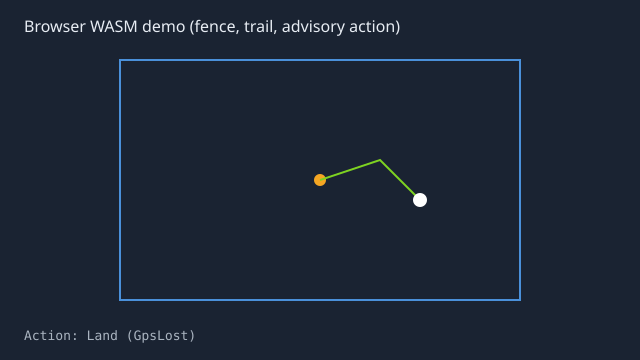
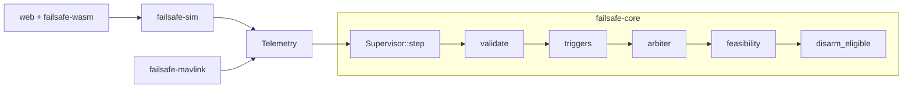

# rust-drone-failsafe

[](https://github.com/applycoding/rust-drone-failsafe/actions/workflows/ci.yml)

**Advisory, heap-free drone failsafe supervisor in Rust**: one `no_std` core for Cortex-M4F, a TOML scenario simulator, MAVLink fixture replay, and a browser WASM demo.

**Live demo:** [applycoding.github.io/rust-drone-failsafe](https://applycoding.github.io/rust-drone-failsafe/) · **Tutorial:** [How I built a drone failsafe monitor in Rust](https://applycoding.com/tutorials/rust-drone-failsafe-no-std-wasm)



> **Honesty:** This project is **educational and advisory**. It is **not flight-tested** and **not certified**. Logic is validated on synthetic traces and property tests (sampled evidence, not proof). MAVLink fixtures are synthetic. Heap-free / `unsafe`-free claims apply to `failsafe-core` source only.

## Why `no_std` here

The supervisor must run on a small MCU with deterministic, panic-free stepping. `failsafe-core` uses fixed-size structures, debounced triggers, and an energy heuristic without heap allocation.

## Architecture



See [docs/state-machine.md](docs/state-machine.md) and [docs/energy.md](docs/energy.md).

## Quickstart (&lt; 5 minutes)

```bash
rustup toolchain install 1.99.1
cargo test --workspace --all-features --locked
cargo run -p failsafe-sim -- crates/failsafe-sim/scenarios/low_battery_far.toml --out trace.csv
cargo test -p failsafe-mavlink -- --nocapture
```

Browser demo (local):

```bash
cargo build -p failsafe-wasm --target wasm32-unknown-unknown --release --locked
# install wasm-bindgen-cli version from Cargo.lock, then:
wasm-bindgen target/wasm32-unknown-unknown/release/failsafe_wasm.wasm --target web --out-dir web/pkg
cd web && npm ci && npx serve -l 8080
```

## Guarantees (scope)

| Claim | Evidence |
| --- | --- |
| `no_std` core, only `libm` | `nostd` CI job, `cargo tree -p failsafe-core` |
| No `Disarm` action; `disarm_eligible` gate | Types + unit tests |
| Disarm hint clears when airborne | `disarm_gate_clears_when_airborne` |
| Energy worked example (21.5625 Wh RTL @ 1500 m) | `energy` tests |
| RTL energy monotone in **distance**, piecewise in altitude | proptest props 10 to 11 |
| 10 scenario expectations | `failsafe-sim` golden tests |
| WASM smoke (GPS kill → Land) | Playwright in CI |

## Results and limits

- **Advisory only**: no commands, no MAVLink TX, no certification path.
- **Energy model**: constant power, flat earth; margin thresholds are tunable heuristics.
- **MAVLink adapter**: receive-only, untrusted UDP optional; mapping isolated in `map.rs`.
- **Triggers**: simplified timing vs a full PX4/ArduPilot stack; tuned for teaching and CI.

## Layout

```
crates/failsafe-core   # no_std supervisor
crates/failsafe-sim    # 2.5D sim + scenarios
crates/failsafe-mavlink
crates/failsafe-wasm
web/                   # static demo (pkg/ generated)
docs/                  # energy + state machine notes
PLAN.md                # build plan (source of truth)
```

## License

MIT OR Apache-2.0; see [LICENSE](LICENSE) and [LICENSE-APACHE](LICENSE-APACHE).
